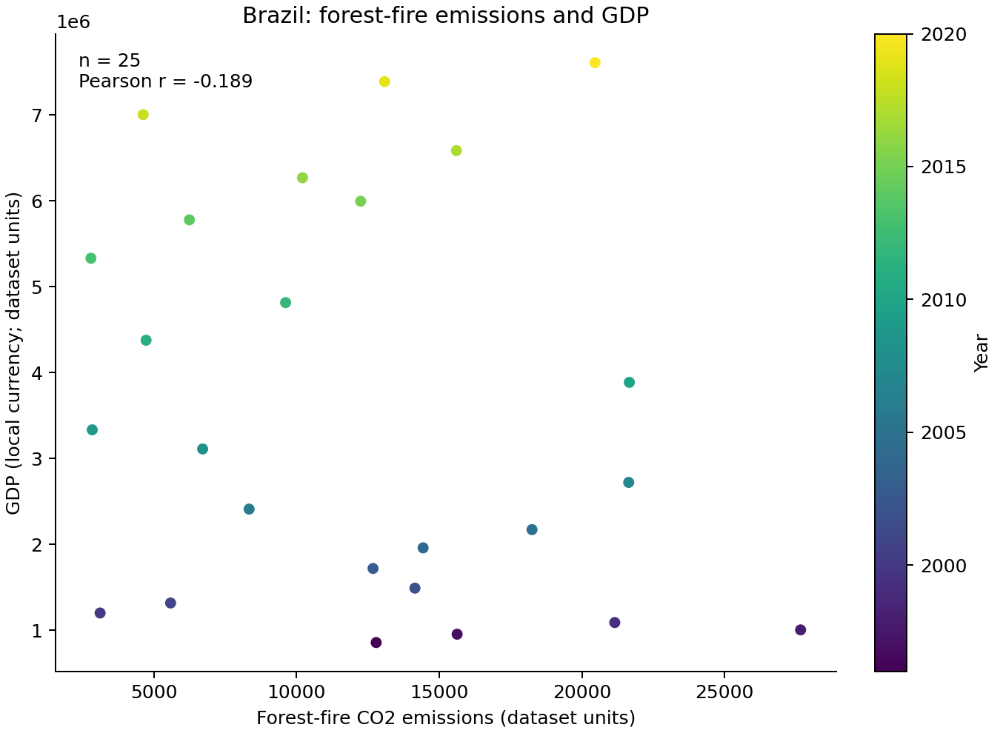
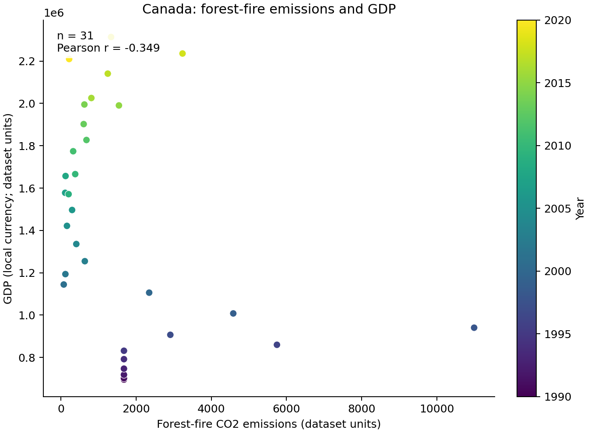
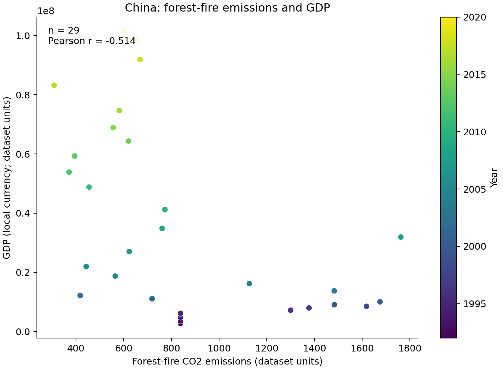
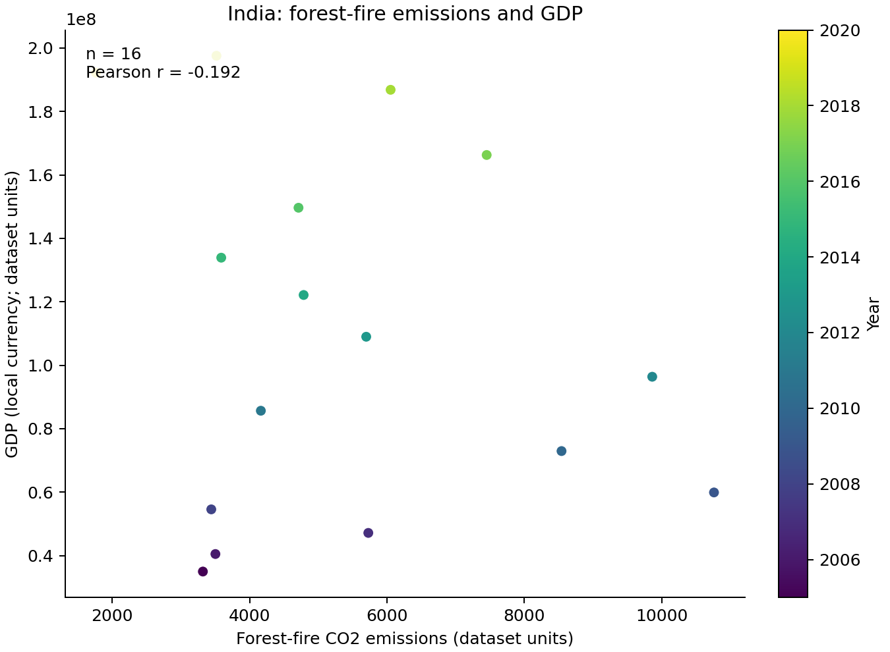

# Forest-Fire Emissions and GDP

## Introduction

This analysis examines the country-level association between forest-fire CO2 emissions and GDP. Each point represents one year with both values available. Countries are plotted separately because GDP is reported in local currency and its numeric scale is not comparable across countries.

## Results

All four countries show a negative Pearson correlation in the paired annual observations, but its strength varies. These are descriptive, contemporaneous associations, not evidence that GDP changes cause forest-fire emissions to change; trends over time and other factors may influence both.

### Brazil

Brazil has 25 paired observations from 1996 through 2020 and a weak negative association (`r = -0.189`).



### Canada

Canada has 31 paired observations from 1990 through 2020 and a modest negative association (`r = -0.349`).



### China

China has 29 paired observations from 1992 through 2020 and the strongest negative association among these countries (`r = -0.514`).



### India

India has 16 paired observations from 2005 through 2020 and a weak negative association (`r = -0.192`).



## Methods

The script reads the downloaded CSV files, selects the forest-fire emissions series and GDP row for each country, joins values by year, and omits years with missing values. It creates one scatterplot per country; points are colored by year, and each chart reports the paired-observation count and Pearson correlation. Correlations are calculated within each country's series and are not pooled. The GDP and emissions axes retain their dataset units.

Run these commands from the repository root to download the data, install the plotting dependency, and create the plots:

```sh
mkdir -p data
curl -L --fail "https://docs.google.com/uc?export=download&id=1AsXP_OGs1O_TDeXiZjk3fYV1SrG4vwXF" -o data/Agrofood_co2_emission.csv
curl -L --fail "https://docs.google.com/uc?export=download&id=19YEPysdnK7VCXuAe9Og9pwYkNT5CbQzr" -o data/IMF_GDP.csv
python3 -m pip install -r requirements.txt
python3 src/scatter.py --countries Brazil Canada China India
```

The command writes `plots/brazil.png`, `plots/canada.png`, `plots/china.png`, and `plots/india.png`. Pass `--countries` with other exact country names to analyze a different set.

## Testing ideas

**1. Unit tests for the Python functions (pytest)**
- Test `get_data`, `get_column_index`, and `get_fire_gdp_year_data` on tiny
  hand-made CSVs (3-5 rows) kept in `tests/fixtures/`.
- Edge cases: country missing from the GDP file, year missing from the GDP
  header, empty strings in a cell, short rows, non-numeric values, an empty file.
- Assert exact outputs, e.g. `[[2000, 1.5, 100.0], [2001, 2.0, 110.0]]`.

**2. Workflow-level checks**
- `snakemake -n` (dry run) confirms the DAG builds and that wildcards resolve
  to the expected files.
- `snakemake --lint` catches style and reproducibility problems.
- `snakemake --dag | dot -Tpng > dag.png` lets us eyeball the structure.
- `snakemake --generate-unit-tests` records the current output of each rule and
  turns it into regression tests that re-run a rule on saved inputs.

**3. Output validation**
- Check that every expected CSV and PNG exists and is non-empty.
- Check CSV schema: columns are `Year, Forest_fires, GDP`; years are integers
  and sorted; no negative fire counts; no NaN values.
- Compare a small known country's output against a checksum or stored
  "golden" file to catch regressions.

**4. Small test dataset**
- Keep a `tests/config.yaml` pointing to a miniature dataset with 2 countries
  so the whole pipeline runs in seconds:
  `snakemake --configfile tests/config.yaml --cores 1`

**5. Reproducibility**
- Pin software versions with a conda `environment.yaml` (or a container) and run
  tests in that environment.
- Run the pipeline twice and confirm that outputs are identical and that a
  second run does nothing ("Nothing to be done").

**6. Continuous integration**
- A GitHub Actions workflow that runs pytest, the dry run, and the small-data
  workflow on every push.

**7. Plot testing**
- Plots are hard to compare pixel by pixel, so test the data passed to them
  (the plotting inputs) and check that the figure is created without errors.
  `pytest-mpl` can do image-comparison tests if needed.